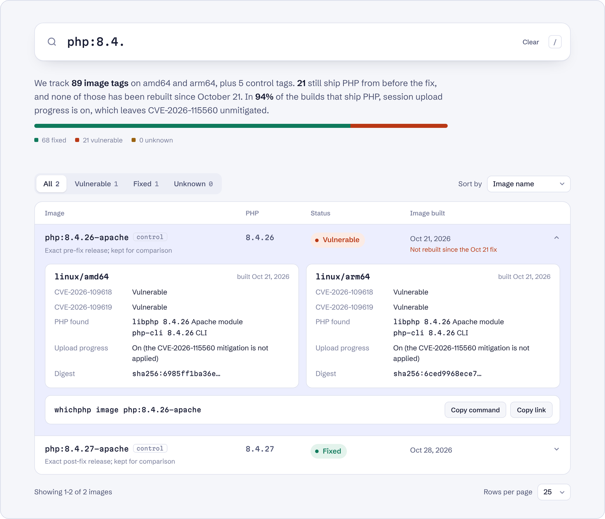
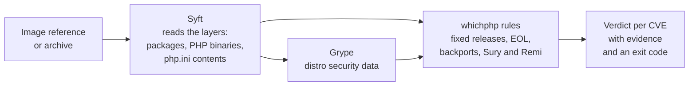

<div align="center">

<picture>
  <source media="(prefers-color-scheme: dark)" srcset="docs/assets/wordmark-dark.svg">
  
</picture>

<h3>Is the PHP in your container image really fixed for PHP2Shell?</h3>

<p>whichphp finds every PHP build inside an image, without running it, and tells you<br>
whether CVE-2026-109618 and CVE-2026-109619 are fixed, and why.</p>

<p>
<a href="https://github.com/yusufyildiz34/whichphp/actions/workflows/ci.yml"></a>
<a href="https://github.com/yusufyildiz34/whichphp/actions/workflows/index.yml"></a>
<a href="go.mod"></a>
<a href="go.mod"></a>
<a href="LICENSE"></a>
<a href="https://github.com/yusufyildiz34/whichphp/stargazers"></a>
</p>

<p>
<a href="https://yusufyildiz34.github.io/whichphp/"></a>
<a href="https://yusufyildiz34.github.io/whichphp/?status=vuln"></a>
<a href="#the-fixes"></a>
<a href="https://github.com/yusufyildiz34/whichphp/tree/data"></a>
</p>

<p>
<a href="https://yusufyildiz34.github.io/whichphp/"><b>Live index</b></a>&emsp;
<a href="#quick-start"><b>Quick start</b></a>&emsp;
<a href="#which-question-are-you-asking">Which question are you asking?</a>&emsp;
<a href="#verdicts">Verdicts</a>&emsp;
<a href="docs/ask-your-host.md">On shared hosting?</a>
</p>

<br>

<a href="https://yusufyildiz34.github.io/whichphp/">
<picture>
  <source media="(prefers-color-scheme: dark)" srcset="docs/assets/index-dark.png">
  
</picture>
</a>

</div>

<br>

> [!IMPORTANT]
> **The fixed releases are 8.5.12, 8.4.27, 8.3.36 and 8.2.35** (October 21, 2026). PHP 8.1 and older get no upstream fix.
>
> **CVE-2026-115560 is still unfixed.** Until PHP's next regular release, set `session.upload_progress.enabled = 0` server-wide.

> [!NOTE]
> whichphp is pre-release. `whichphp image` and the [GitHub Action](#use-it-in-ci) work today if you [install from source](#quick-start), and the [public index](https://yusufyildiz34.github.io/whichphp/) updates daily. Release binaries ship on November 4, 2026.

## Why whichphp

The usual checks give confident answers that are often wrong for PHP2Shell.

| The usual check | What it misses | What whichphp does |
|---|---|---|
| `php -v` | Distro backports keep the old version number, and the CLI isn't what serves your site | Reads the package release and every PHP binary: CLI, FPM, `mod_php`, CGI, embedded |
| A package-based scanner | The official `php` images compile PHP from source, so no package manager knows about it | Uses Syft's PHP interpreter cataloger and Grype, then adds the backport rules |
| The image tag | A rebuilt tag doesn't change a container that is already running | Shows when each tag was built and the first digest that carried the fix |

Every verdict comes with its evidence: which binary, which package release, which data source. When the evidence isn't there, whichphp says `UNKNOWN` instead of guessing.

## Quick start

whichphp needs [Syft](https://github.com/anchore/syft) and [Grype](https://github.com/anchore/grype) on your `PATH`. Install whichphp with Go 1.24 or later:

```sh
go install github.com/yusufyildiz34/whichphp/cmd/whichphp@latest
```

From November 4, the [releases page](https://github.com/yusufyildiz34/whichphp/releases) also has binaries for Linux, macOS and Windows on amd64 and arm64, with SHA256 checksums and signed build provenance. Check a download before you run it:

```sh
sha256sum --ignore-missing -c SHA256SUMS
gh attestation verify whichphp_*_linux_amd64.tar.gz --repo yusufyildiz34/whichphp
```

Then check an image:

```sh
whichphp image php:8.4-apache
whichphp image --platform linux/arm64 wordpress:latest
whichphp image -o table -o sarif=whichphp.sarif -o openvex=whichphp.vex.json ghcr.io/acme/app:1.2
whichphp image docker-archive:image.tar
```

```text
$ whichphp image php:8.4.26-apache
Image:   php:8.4.26-apache
Distro:  debian 13.7 (supported)
Serves:  apache mod_php

PHP      VERSION  SOURCE          SAPI           2026-109618  2026-109619
libphp   8.4.26   upstream-build  apache-module  VULNERABLE   VULNERABLE
php-cli  8.4.26   upstream-build  cli            VULNERABLE   VULNERABLE

Why:
  libphp 8.4.26 (CVE-2026-109618, CVE-2026-109619): 8.4.26 is older than 8.4.27, the first fixed 8.4 release
    evidence: /usr/lib/apache2/modules/libphp.so
  ...

Result: ACTION NEEDED: rebuild or replace this image (exit 1)
```

<details>
<summary><b>Flags</b></summary>
<br>

| Flag | What it does |
|---|---|
| `--platform linux/arm64` | Check one architecture of a multi-arch image |
| `-o <format>[=<file>]` | `table` (default), `json`, `sarif` for code scanning, or `openvex`. Repeat it to write several formats in one run; only one can go to stdout. Files are written only when the run succeeds |
| `--vex-author "Acme Security"` | Who issues the OpenVEX document; VEX consumers trust statements by their author |
| `--sbom syft.json` / `--grype-json grype.json` | Reuse output you already have instead of scanning again |
| `--no-grype` | Skip the vulnerability database; distro packages then get `UNKNOWN` |
| `--fail-on-mitigation` | Also exit 1 when `session.upload_progress` is on |
| `--max-db-age 7` | Days after which Grype's database counts as stale |

</details>

## Use it in CI

The GitHub Action checks an image, writes the result to the job summary, and fails the step when the image needs action. It can also send the findings to GitHub code scanning.

```yaml
jobs:
  whichphp:
    runs-on: ubuntu-latest
    permissions:
      contents: read
      security-events: write # only for upload-sarif
      actions: read # only for upload-sarif in a private repository
    steps:
      - uses: yusufyildiz34/whichphp@v0.1.0 # until the first release, use @main
        with:
          image: ghcr.io/acme/app:latest
          upload-sarif: true
```

It also works on an image built earlier in the same job, since Syft reads the local Docker daemon.

<details>
<summary><b>Inputs and outputs</b></summary>
<br>

| Input | Default | What it does |
|---|---|---|
| `image` | required | The image to check |
| `platform` | | One architecture of a multi-arch image, e.g. `linux/arm64` |
| `fail-on` | `action-needed` | `action-needed`, `unknown` (also fail when the evidence is inconclusive), or `never`. A scan error always fails |
| `fail-on-mitigation` | `false` | Also fail when `session.upload_progress` is on |
| `sarif-file` | `whichphp.sarif` | Where to write the SARIF report |
| `upload-sarif` | `false` | Upload the report to code scanning; needs `security-events: write`. Skipped on pull requests from forks |
| `category` | one per image | Code scanning category. The default, `whichphp/<repository>[/<platform>]`, leaves out the tag so per-commit tags keep their alerts together; set it when one workflow uploads several tags of the same image |
| `syft-version`, `grype-version` | pinned | Tool versions to install |

| Output | Value |
|---|---|
| `action` | `OK`, `ACTION_NEEDED`, `UNKNOWN`, `NO_PHP`, or `ERROR` |
| `exit-code` | whichphp's exit code |
| `sarif-file`, `json-file` | Paths of the reports |

A release tag (`@v0.1.0`) downloads that release and checks both its checksum and its signed build provenance. A branch or commit builds whichphp from source, setting up Go first if the runner has none. The tools stay out of your job's `PATH`.

</details>

## Which question are you asking?

| Your question | Short answer | Where to look |
|---|---|---|
| "`php -v` says 8.3.6. Am I patched?" | The version number alone can't tell you. Distros backport fixes without changing it. | [Why `php -v` lies](#why-php--v-lies), `whichphp image` |
| "Is the image tag I pull fixed yet?" | Floating tags were rebuilt within days. Pinned and end-of-life tags often never are. | [The live index](https://yusufyildiz34.github.io/whichphp/), `whichphp image <ref>` |
| "Which PHP actually serves my site?" | Often not the one `php -v` shows. Images and hosts can carry several builds. | `whichphp image` lists every binary and SAPI |
| "I'm on PHP 8.1 or older." | There is no upstream fix. Treat it as vulnerable unless your vendor proves a backport. | [Verdicts](#verdicts) |
| "Is the CVE-2026-115560 mitigation on?" | In most images it isn't. Official images ship no `php.ini`, so the compiled default (on) applies. | `whichphp image` reports the effective value |
| "My scanner says the image is clean." | Package-based scanners can't see PHP compiled from source. | [Why your scanner says clean](#why-your-scanner-says-clean) |
| "Do I need to restart or redeploy?" | Yes. A running container keeps the old image until it is recreated. Save logs first. | Cluster mode (v0.2) |
| "My site is on shared hosting." | You can't scan it yourself. Ask your host the right questions. | [What to ask your host](docs/ask-your-host.md) |
| "Was I compromised?" | whichphp can't tell you. A "fixed" verdict says nothing about what happened before. | [NCSC-NL PHP2Shell repository](https://github.com/NCSC-NL/php2shell) and your vendor's guidance |
| "Does a WAF protect me?" | Only partly, and only as a stopgap. Rules can miss variants. | [FAQ](#faq) |

## Verdicts

whichphp gives one verdict per CVE.

| Verdict | Meaning |
|---|---|
| `FIXED` | The PHP version includes the upstream fix |
| `FIXED_BY_DISTRO_BACKPORT` | The version looks old, but the distro's package release includes the fix |
| `VULNERABLE` | The fix exists upstream, but this build doesn't have it |
| `VULNERABLE_EOL` | The branch or base OS is end-of-life and no fix is proven |
| `NEEDS_VENDOR_CONFIRMATION` | A third-party build whose fix status only the vendor can confirm |
| `UNKNOWN` | Not enough evidence; the output says what is missing |
| `DATA_STALE` | The vulnerability data is too old to trust |
| `NOT_AFFECTED` | The version is older than the first affected release for this CVE |

| Exit code | Meaning |
|---|---|
| `0` | Fixed, or no PHP in the image |
| `1` | Action needed |
| `2` | Unknown |
| `3` | Error |

An `UNKNOWN` is an honest answer, not a failure, and whichphp never turns it into "safe."

**In SARIF and OpenVEX.** Vulnerable verdicts are SARIF errors and uncertain ones are warnings; fixed PHP produces no result. OpenVEX says `fixed` or `not_affected` only on positive evidence, so a VEX consumer never hides a scanner's finding because whichphp found nothing: uncertain verdicts, unconfirmed backports and images with no PHP found are `under_investigation`.

## How it works



1. **Syft reads the image layers.** whichphp asks it to catalog packages and binaries and to capture the contents of PHP configuration files. Nothing in the image runs.
2. **Grype checks distro packages** against the distros' own security data, which is where backports show up.
3. **whichphp applies the PHP-specific rules:** fixed releases per branch, end-of-life branches and distros, third-party repositories that ship upstream releases (Sury, Remi), pre-release builds, and the effective `php.ini` settings.

**How we checked it**

| Test | Result |
|---|---|
| Scans of popular images, amd64 and arm64 | 188 |
| CVE verdicts that matched our own analysis | 376 of 376 |
| Pre-fix official `php` images (image and architecture) flagged by Grype | 6 of 6 |
| The same images flagged by Trivy | 0 of 6 |

## The index

The [live index](https://yusufyildiz34.github.io/whichphp/) covers the tags listed in [`index/images.csv`](index/images.csv) on amd64 and arm64. For each one it shows the PHP inside, the verdict, when the tag was last built and when it first carried the fix. Search any tag, filter by status, and share the link to a filtered view.

`whichphp index` builds it. Each daily run checks every tag's digest with a HEAD request, which doesn't count toward Docker Hub's pull limits. It rescans only tags that are new, changed, failed last time, or haven't been scanned for seven days, because distro security data can change without a new image.

```sh
./whichphp index --images index/images.csv --data data --platforms linux/amd64,linux/arm64
```

The run writes `index.json`, a change log in `history.jsonl`, and the [shields.io endpoint badges](https://shields.io/badges/endpoint-badge) shown at the top of this page. In CI the data lives on the [`data` branch](https://github.com/yusufyildiz34/whichphp/tree/data), and [`site/index.html`](site/index.html) renders it. Set `DOCKERHUB_USERNAME` and `DOCKERHUB_TOKEN` for authenticated pulls.

Missing an image? [Suggest it](https://github.com/yusufyildiz34/whichphp/issues/new?template=add-image.yml). Think a verdict is wrong? [Report it with evidence](https://github.com/yusufyildiz34/whichphp/issues/new?template=wrong-verdict.yml).

## The fixes

| Branch | First fixed release (Oct 21, 2026) |
|---|---|
| 8.5 | 8.5.12 |
| 8.4 | 8.4.27 |
| 8.3 | 8.3.36 |
| 8.2 | 8.2.35 (the branch reaches end of life on Dec 31, 2026) |
| 8.1 and older | No upstream fix |

- **Affected versions.** NVD lists CVE-2026-109618 as affecting PHP from 7.3.0 and CVE-2026-109619 from 5.4.0.
- **CVE-2026-115560 has no fix yet.** Until PHP's next regular release, the mitigation is `session.upload_progress.enabled = 0`, set server-wide.

### Why `php -v` lies

1. **Distros backport fixes without changing the version.** Ubuntu 24.04 ships PHP 8.3.6. Its security fixes show up in the package release (`8.3.6-0ubuntu0.24.04.N`), not in the version number. A checker that compares `8.3.6` with `8.3.36` gets it wrong.
2. **The CLI is not what serves your site.** `php -v` runs the command-line binary. Your site runs on PHP-FPM or Apache's `mod_php`, which can be a different build.
3. **Containers keep the image they started with.** A tag can be rebuilt with a fixed PHP while your running container still uses the old one.

### Why your scanner says clean

The official `php` images compile PHP from source. No package manager knows about it, so package-based scanners don't see it.

- **Trivy, and tools built on it, don't detect it.** Trivy's maintainers closed a pull request for PHP binary detection and said compiled-binary detection belongs to Aqua's commercial scanner ([aquasecurity/trivy#6524](https://github.com/aquasecurity/trivy/pull/6524)).
- **Syft and Grype do.** Syft has a PHP interpreter cataloger ([source](https://github.com/anchore/syft/blob/main/syft/pkg/cataloger/php/interpreter_cataloger.go)), and Grype matches what it finds.

whichphp builds on Syft and Grype rather than replacing them. It adds the backport logic, the settings and the explanation.

## Limits

**What a verdict does not prove**

- **Runtime overrides are invisible.** Environment variables, mounted ConfigMaps or pool files can change settings after the image is built.
- **Distro data can lag.** A backport may exist before the vulnerability feed knows about it.
- **Private backports can't be recognized.** A source build patched by hand looks like the unpatched version.
- **"Fixed" says nothing about earlier compromise.**
- **CVE-2026-115560 stays open everywhere** until PHP's next regular release.

**What whichphp never does**

- It never runs an image or sends traffic to any server.
- It contains no exploit code or payloads.
- It never says "not compromised."
- It doesn't fix anything automatically.

## FAQ

<details>
<summary><b>A scanner tried to exploit my site and couldn't. Am I safe?</b></summary>
<br>
No. A failed attempt shows that one technique didn't work under those conditions. Check the PHP build itself.
</details>

<details>
<summary><b>My logs show PHP2Shell patterns. Was I compromised?</b></summary>
<br>
Not necessarily. A match shows an attempt. Confirming a compromise needs more evidence. See the <a href="https://github.com/NCSC-NL/php2shell">NCSC-NL repository</a> and your vendor's guidance.
</details>

<details>
<summary><b>I'm about to recreate my containers. Anything to do first?</b></summary>
<br>
Save the logs and anything you may want to examine. Recreating a container deletes its logs and writable layer, which a compromise check may need.
</details>

<details>
<summary><b>Is a WAF enough?</b></summary>
<br>
No. It can block known patterns while you patch, but rules miss variants. Patch, and turn upload progress off.
</details>

<details>
<summary><b>The update broke my app. Should I go back to the old version?</b></summary>
<br>
No. The old version is vulnerable. Known regressions in 8.4.27 and 8.5.12 are being fixed upstream. Check the php-src issue tracker for your symptom.
</details>

## Roadmap

- [x] `whichphp image`: every PHP binary and SAPI, backport-aware verdicts, effective `php.ini` settings
- [x] A daily public index for amd64 and arm64, with shields.io badges
- [x] SARIF and OpenVEX output
- [x] A GitHub Action, with code scanning upload
- [ ] Release binaries with checksums and signed build provenance (first release November 4, 2026)
- [ ] `whichphp cluster`: what each pod actually runs and what to redeploy (v0.2)
- [ ] Per-tag "tell me when it's fixed" feeds (v0.2)
- [ ] Fixed-build data for third-party packagers: Sury, Remi, GetPageSpeed, TuxCare, Freexian, CloudLinux, cPanel
- [ ] CycloneDX export, a diff mode, and base-image lineage

## Related tools

- **[Syft](https://github.com/anchore/syft) and [Grype](https://github.com/anchore/grype):** SBOMs and vulnerability matching. whichphp builds on them.
- **[NCSC-NL/php2shell](https://github.com/NCSC-NL/php2shell):** the status of vendor products and appliances.
- **[getastra/php2shell-triage](https://github.com/getastra/php2shell-triage) and [php2shell-doctor](https://github.com/andreysheva/php2shell-doctor):** checks for regular servers.

## Contributing

See [CONTRIBUTING.md](CONTRIBUTING.md). Verdict corrections need evidence, and new test cases are very welcome ([testdata/cases](testdata/cases/README.md)). To report a security problem in whichphp itself, see [SECURITY.md](SECURITY.md).

## License

[Apache License 2.0](LICENSE). The fonts in `site/fonts` are under the [SIL Open Font License](site/fonts/OFL-schibsted-grotesk.txt).
