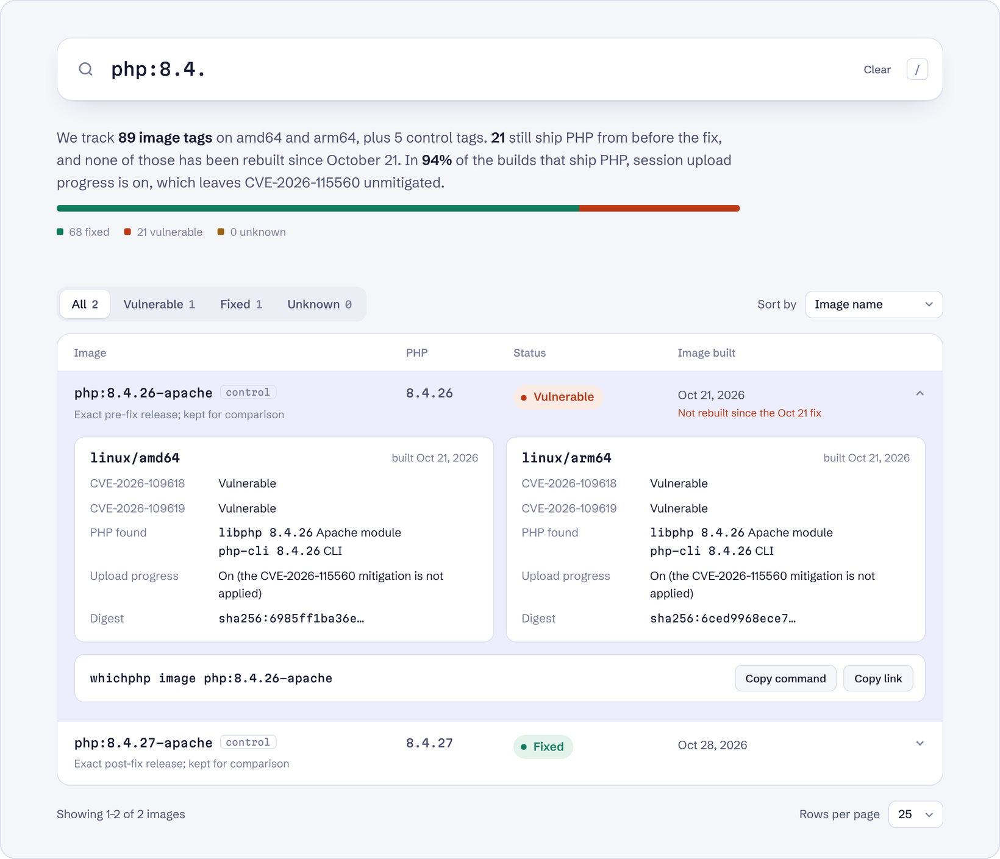
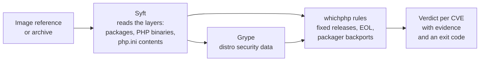

<div align="center">

<picture>
  <source media="(prefers-color-scheme: dark)" srcset="docs/assets/wordmark-dark.svg">
  
</picture>

<h3>Is the PHP in your container image really fixed for PHP2Shell?</h3>

<p>whichphp finds every PHP build inside an image, without running it, and tells you<br>
whether CVE-2026-109618 and CVE-2026-109619 are fixed, and why.</p>

<p>
<a href="https://github.com/yusufyildiz34/whichphp/actions/workflows/ci.yml"></a>
<a href="https://github.com/yusufyildiz34/whichphp/actions/workflows/index.yml"></a>
<a href="go.mod"></a>
<a href="go.mod"></a>
<a href="LICENSE"></a>
<a href="https://scorecard.dev/viewer/?uri=github.com/yusufyildiz34/whichphp"></a>
<a href="https://www.bestpractices.dev/projects/16111"></a>
<a href="https://github.com/yusufyildiz34/whichphp/releases/latest"></a>
<a href="https://github.com/yusufyildiz34/whichphp/stargazers"></a>
</p>

<p>
<a href="https://yusufyildiz34.github.io/whichphp/"></a>
<a href="https://yusufyildiz34.github.io/whichphp/?status=vuln"></a>
<a href="#the-fixes"></a>
<a href="https://github.com/yusufyildiz34/whichphp/tree/data"></a>
</p>

<p>
<a href="https://yusufyildiz34.github.io/whichphp/"><b>Live index</b></a>&emsp;
<a href="#quick-start"><b>Quick start</b></a>&emsp;
<a href="#which-question-are-you-asking">Which question are you asking?</a>&emsp;
<a href="#verdicts">Verdicts</a>&emsp;
<a href="docs/ask-your-host.md">On shared hosting?</a>
</p>

<br>

<a href="https://yusufyildiz34.github.io/whichphp/">
<picture>
  <source media="(prefers-color-scheme: dark)" srcset="docs/assets/index-dark.png">
  
</picture>
</a>

</div>

<br>

> [!IMPORTANT]
> **The fixed releases are 8.5.12, 8.4.27, 8.3.36 and 8.2.35** (October 21, 2026). PHP 8.1 and older get no upstream fix.
>
> **CVE-2026-115560 is still unfixed.** Until PHP's next regular release, set `session.upload_progress.enabled = 0` server-wide.

> [!NOTE]
> whichphp is new: v0.1.0 was its first release. [Report a wrong verdict](https://github.com/yusufyildiz34/whichphp/issues/new?template=wrong-verdict.yml) with evidence and it gets fixed in the next release and the next [index](https://yusufyildiz34.github.io/whichphp/) run.

## Why whichphp

The usual checks give confident answers that are often wrong for PHP2Shell.

| The usual check | What it misses | What whichphp does |
|---|---|---|
| `php -v` | Distro backports keep the old version number, and the CLI isn't what serves your site | Reads the package release and every PHP binary: CLI, FPM, `mod_php`, CGI, embedded |
| A package-based scanner | The official `php` images compile PHP from source, so no package manager knows about it | Uses Syft's PHP interpreter cataloger and Grype, then adds the backport rules |
| The image tag | A rebuilt tag doesn't change a container that is already running | Shows when each tag was built and the first digest that carried the fix |

Every verdict comes with its evidence: which binary, which package release, which data source. When the evidence isn't there, whichphp says `UNKNOWN` instead of guessing.

## Quick start

whichphp needs [Syft](https://github.com/anchore/syft) and [Grype](https://github.com/anchore/grype) on your `PATH`.

Download whichphp for Linux, macOS or Windows (amd64 or arm64) from the [latest release](https://github.com/yusufyildiz34/whichphp/releases/latest). Every release has SHA256 checksums and signed build provenance, so check the download before you run it:

```sh
sha256sum --ignore-missing -c SHA256SUMS        # on macOS: shasum -a 256 --ignore-missing -c SHA256SUMS
gh attestation verify whichphp_*_linux_amd64.tar.gz --repo yusufyildiz34/whichphp \
  --signer-workflow yusufyildiz34/whichphp/.github/workflows/release.yml
# or with the provenance bundle from the release, without GitHub's attestation API:
gh attestation verify whichphp_*_linux_amd64.tar.gz --repo yusufyildiz34/whichphp \
  --signer-workflow yusufyildiz34/whichphp/.github/workflows/release.yml --bundle whichphp_*.sigstore.json
```

Or install it with Go 1.24 or later:

```sh
go install github.com/yusufyildiz34/whichphp/cmd/whichphp@latest
```

Then check an image:

```sh
whichphp image php:8.4-apache
whichphp image --platform linux/arm64 wordpress:latest
whichphp image -o table -o sarif=whichphp.sarif -o openvex=whichphp.vex.json \
  -o cyclonedx=whichphp.cdx.json ghcr.io/acme/app:1.2
whichphp image docker-archive:image.tar
```

```text
$ whichphp image php:8.4.26-apache
Image:   php:8.4.26-apache
Distro:  debian 13.7 (supported)
Serves:  apache mod_php
Base:    php:8.4.26-apache-trixie (from the image's environment)

PHP      VERSION  SOURCE          SAPI           2026-109618  2026-109619
libphp   8.4.26   upstream-build  apache-module  VULNERABLE   VULNERABLE
php-cli  8.4.26   upstream-build  cli            VULNERABLE   VULNERABLE

Why:
  libphp 8.4.26 (CVE-2026-109618, CVE-2026-109619): 8.4.26 is older than 8.4.27, the first fixed 8.4 release
    evidence: /usr/lib/apache2/modules/libphp.so
  ...

Notes:
  - This image was built on the official php image with PHP 8.4.26. Rebuild it on the current php:8.4-apache, which has 8.4.27 or later.

Result: ACTION NEEDED: rebuild or replace this image (exit 1)
```

**Which image to rebuild on.** An image built on an official `php` image inherits its environment (`PHP_VERSION`, the php.net download URL, `APACHE_CONFDIR`), so whichphp can tell which `php` image an app image came from, even years later, without asking a registry. When that PHP is still in the image and vulnerable, the report names the floating `php` tag to rebuild on (`php:8.4-apache`, `php:8.4-fpm-alpine`: the official image stops updating tags for old Debian and Alpine releases), or says the branch gets no fix. It recognizes Bitnami's `php-fpm` images the same way. The tag is reconstructed from the environment and the distro, so `cli` and `zts` images show no variant.

<details>
<summary><b>Flags</b></summary>
<br>

| Flag | What it does |
|---|---|
| `--platform linux/arm64` | Check one architecture of a multi-arch image |
| `-o <format>[=<file>]` | `table` (default), `json`, `sarif` for code scanning, `openvex`, or `cyclonedx` (a CycloneDX 1.6 BOM with VEX). Repeat it to write several formats in one run; only one can go to stdout. Files are written only when the run succeeds, and never over an input, under any name |
| `--vex-author "Acme Security"` | Who issues the OpenVEX document, and the author of the CycloneDX BOM; VEX consumers trust statements by their author |
| `--sbom syft.json` / `--grype-json grype.json` | Reuse output you already have instead of scanning again |
| `--no-grype` | Skip the vulnerability database; distro packages then get `UNKNOWN` |
| `--fail-on-mitigation` | Also exit 1 when `session.upload_progress` is on |
| `--max-db-age 7` | Days after which Grype's database counts as stale |

</details>

## Use it in CI

The GitHub Action checks an image, writes the result to the job summary, and fails the step when the image needs action. It can also send the findings to GitHub code scanning.

```yaml
jobs:
  whichphp:
    runs-on: ubuntu-latest
    permissions:
      contents: read
      security-events: write # only for upload-sarif
      actions: read # only for upload-sarif in a private repository
    steps:
      - uses: yusufyildiz34/whichphp@v0.4.0
        with:
          image: ghcr.io/acme/app:latest
          upload-sarif: true
```

It also works on an image built earlier in the same job, since Syft reads the local Docker daemon.

<details>
<summary><b>Inputs and outputs</b></summary>
<br>

| Input | Default | What it does |
|---|---|---|
| `image` | required | The image to check |
| `platform` | | One architecture of a multi-arch image, e.g. `linux/arm64` |
| `fail-on` | `action-needed` | `action-needed`, `unknown` (also fail when the evidence is inconclusive), or `never`. A scan error always fails |
| `fail-on-mitigation` | `false` | Also fail when `session.upload_progress` is on |
| `sarif-file` | `whichphp.sarif` | Where to write the SARIF report |
| `upload-sarif` | `false` | Upload the report to code scanning; needs `security-events: write`. Skipped on pull requests from forks |
| `category` | one per image | Code scanning category. The default, `whichphp/<repository>[/<platform>]`, leaves out the tag so per-commit tags keep their alerts together; set it when one workflow uploads several tags of the same image |
| `syft-version`, `grype-version` | pinned | Tool versions to install |

| Output | Value |
|---|---|
| `action` | `OK`, `ACTION_NEEDED`, `UNKNOWN`, `NO_PHP`, or `ERROR` |
| `exit-code` | whichphp's exit code |
| `sarif-file`, `json-file` | Paths of the reports |
| `install` | How whichphp was installed: `release-verified`, `release-checksum-only` (the runner's `gh` couldn't check provenance), or `source` |

A release tag (`@v0.4.0`) downloads that release and checks its checksum and, when the runner's `gh` can, its signed build provenance. The provenance is checked against the Sigstore bundle published with the release, which needs no GitHub API access and no token, so it also works on GitHub Enterprise Server and GHE.com runners that can reach `github.com`, `release-assets.githubusercontent.com` and `tuf-repo-cdn.sigstore.dev` (plus `tuf-repo.github.com` with gh older than 2.83). If that check fails or can't run, the action asks GitHub's attestation API instead, which can't succeed on GitHub Enterprise because the job's token isn't valid on github.com. Both enforce the same signer workflow and tag, plus the commit for a SHA pin, and the step fails if neither passes. Pinned by the commit SHA of a release, the action downloads the release only when the runner's `gh` can check that the binary was built from exactly that commit, and the step fails if that check fails; when `gh` can't check it, the action builds that commit from source and says why in a notice. A release that isn't downloadable yet (a tag pushed minutes ago) also builds from source, with a notice. So you can pin the action by SHA, as many security policies require, and never trust more than the source you pinned. Any other branch or commit builds whichphp from source, setting up Go first if the runner has none. Syft and Grype are installed from their release archives; the default versions are checked against SHA-256 hashes pinned in [`scripts/install-tools.sh`](scripts/install-tools.sh), and other versions against their release's checksums file, with a warning. None of these tools go on your job's `PATH`.

</details>

## Check a Kubernetes cluster

A running pod keeps the image it started with, even after its tag was rebuilt with the fix. `whichphp cluster` reads which image digest each pod actually runs, checks it, and tells you per workload whether a redeploy is enough or the image itself has to be rebuilt.

```sh
whichphp cluster --context my-cluster
whichphp cluster --context my-cluster -n shop -o table -o json=cluster.json
```

In this example, `shop/web` sets `imagePullPolicy: Always` and mounts a `php.ini` snippet from the ConfigMap `php-ini`:

```text
Context: my-cluster
Checked 3 running pods: 3 images in 2 workloads.

ACTION NEEDED  legacy/Deployment/app
  running vulnerable PHP since Aug 3, 2026, 90 days
  app: php:8.1-apache on linux/arm64, 1 pod
    running sha256:c03e58a7d114…
    PHP 8.1.33: end-of-life PHP
    session.upload_progress.enabled: on, from the image
    The tag still points to this image: rebuild it on a fixed PHP or move to a fixed tag, then redeploy.

ACTION NEEDED  shop/Deployment/web
  running vulnerable PHP since Oct 12, 2026, 20 days
  php: php:8.4-apache on linux/amd64, 2 pods
    running sha256:5b6a1f0f9c2e…
    PHP 8.4.26: vulnerable
    session.upload_progress.enabled: off, set in ConfigMap php-ini (/usr/local/etc/php/conf.d/zz-mitigation.ini)
    the tag now points to sha256:9e41c7d2a0b8…: fixed
    The tag now points to a fixed image: redeploy to pick it up.
  Redeploy: kubectl --context my-cluster -n shop rollout restart deployment/web

Before you redeploy: recreating a pod deletes its logs and writable layer. If you need to check whether it was compromised, save them first.
Settings come from the images and from the ConfigMaps mounted at PHP configuration paths; Secrets, other volumes and environment variables aren't read.
```

- **Read-only.** It runs `kubectl get pods`, `kubectl get nodes` and, for the ConfigMaps mounted at PHP configuration paths or listed in a container's `envFrom`, `kubectl get configmap` against the context you name, and reads images from their registries (or, with `--from-docker`, from the local Docker daemon). It changes nothing in the cluster and runs nothing. `--context` is required, so it never uses your current context by accident.
- **What it checks.** Every container of every running pod, including init containers, on its node's platform, using the digest from the pod status. Pods running the same image are checked once. When an image given by tag isn't fixed, it also looks up what the tag points to now and, if that changed, checks the new image too.
- **Since when.** For a workload whose pods run vulnerable or end-of-life PHP, the report says since when: the earliest start of a pod running that image, as a date and a number of days (`exposure` in JSON). A pod's start counts rather than its container's, since a container that restarted ran the same image before; only a pod whose status has no start time counts from its running container's start. An init container that has finished doesn't count, and neither does a pod that may run an image other than the one checked.
- **Settings.** `session.upload_progress.enabled` is worked out per container from the image's configuration files and the ConfigMaps the pod mounts over them, as Kubernetes mounts them: a file mounted with `subPath` replaces the image's file at that path, and a ConfigMap mounted as a directory hides the image's directory. A ConfigMap is read only when it is mounted where whichphp reads PHP configuration in images (a `php.ini`, a `conf.d` or `php.d` directory, or FPM `.conf` files, under `/etc`, `/usr/local/etc` or `/opt` in a path that names PHP or FPM), and only once. `items`, `optional: true` (a missing ConfigMap mounts as an empty directory) and `subPathExpr` with variables from the container's `env` list work as in Kubernetes.
  - **Only where the image's PHP reads.** PHP reads `php.ini` and scans for `.ini` files in directories compiled into it, so a file from a ConfigMap counts only where the image's own files show that PHP reads: the `php.ini` of one of the image's `php.ini` trees, a `conf.d` or `php.d` directory that holds the image's own `.ini` files, or the image's own FPM `.conf` files and the directories of its pool files. A file anywhere else is left out with a note, and when it would change the setting, the setting is `unknown`: on the official `php` image, which scans `/usr/local/etc/php/conf.d`, a file at `/usr/local/etc/php/php.d/zz-off.ini`, or a ConfigMap mounted at `/usr/local/etc` that holds `php.ini`, doesn't turn it off.
  - **What isn't read.** When a ConfigMap can't be read (forbidden, or deleted since the pod started), a Secret or another kind of volume is mounted there, a `subPathExpr` uses variables the pod spec doesn't set, or `PHP_INI_SCAN_DIR` or `PHPRC` is set, which whichphp doesn't follow, the report names it. Those variables are looked for in the `env` list and, with their `prefix`, in the ConfigMaps of `envFrom`; a Secret in `envFrom` is never read, so it may set them, and so may an `envFrom` ConfigMap that can't be read. Any of these could turn the setting back on, so an `off` becomes `unknown`; an `on` stays.
  - **PHP's command line.** PHP's options in the container's `command` and `args`, or in the script a shell's `-c` runs there, override the files: `-d` naming `session.upload_progress.enabled`, `-c` or `--php-ini` (unless it names the image's own `php.ini` or its directory), `-n` or `--no-php-ini`, and FPM's `-y` or `--fpm-config` (unless it names the image's own `php-fpm.conf`) and `-p` or `--prefix`, alone or grouped (`-Fn`). Any other argument is one word, spaces and all. They count only as options of a `php`, `php-fpm` or `php-cgi` program, before its script and before the next command, so `php artisan queue:work -n` and `supervisord -c` don't. With any of them the setting is `unknown`, unless a `-d` turns it on. A word that sets `PHPRC` or `PHP_INI_SCAN_DIR` there (`PHPRC=/srv php-fpm`, after `export` or `env`) counts as that variable in the `env` list does.
- **Cut-off downloads.** When Syft's download of an image is cut off or reset (the error Syft ends with says `unexpected EOF`, `connection reset by peer`, `TLS handshake timeout` or `i/o timeout`; its warnings about files inside the image don't count), whichphp reads the image once more, and the report says so. An archive or directory on disk is never read twice. `whichphp image` does the same.
- **Redeploy or rebuild.** The `Redeploy:` command appears only when every container that needs action would get a fixed image from its tag and pulls the tag on every start (`imagePullPolicy: Always`). With `IfNotPresent`, the default for most tags, nodes that already have the old image keep using it, so the advice says to pin the new digest or change the policy first. The command names the same `--context`, and the same `--kubeconfig` or `KUBECONFIG`, that the check read. On Windows, when `KUBECONFIG` lists several files or a value contains `%`, `$` or a backtick, the report gives no command and says why.
- **What it needs.** `kubectl`, `syft` and `grype` on `PATH`, and permission to list pods. Listing nodes is optional; without it, each image is checked for its default platform and pods on Windows nodes aren't skipped. Reading ConfigMaps is optional too; without it, the report names the ConfigMaps it couldn't read. Syft reads private images with the credentials in your Docker config. The lookup of what a tag points to now is anonymous, except on Docker Hub with `DOCKERHUB_USERNAME` and `DOCKERHUB_TOKEN`, so for a private registry it can fail; the report then says the tag couldn't be checked.
- **Exit codes.** 0: nothing to do. 1: at least one workload needs action. 2: whichphp couldn't prove an image fixed, or couldn't check one. 3: an error, such as a cluster that couldn't be read, no running pods to check, Syft or Grype missing, or an interrupted run.

| Flag | What it does |
|---|---|
| `--context <name>` | The kubectl context to read (required) |
| `-n <namespace>` | Only this namespace. By default, every namespace except `kube-system`, `kube-public` and `kube-node-lease` |
| `-l <selector>` | Only pods matching a label selector, e.g. `app=shop` |
| `--include-system` | Also check the system namespaces |
| `--kubeconfig <file>` | A kubeconfig other than kubectl's default |
| `-o table\|json[=<file>]` | Output, repeatable, as for `whichphp image` |
| `--max-db-age 7` | Days after which Grype's database counts as stale |
| `--from-docker` | Read each running image from the local Docker daemon when it's there, else from its registry (see below) |
| `--verbose` | Pass Syft's and Grype's own output through to stderr |

**Local images.** On Docker Desktop's Kubernetes, pods run images from Docker Desktop's own Docker Engine, which may never have been pushed to a registry, and downloading the others from their registries can be slow. With `--from-docker`, whichphp looks each running image up in the local Docker daemon with `docker image inspect`, matching the image digest or image ID in the pod status, and when it's there, Syft reads it from the daemon (its `docker:` source) instead of the registry. An image that isn't there, or is there for another platform, is read from its registry as before, and the report says so. So is an image Syft reads from the daemon for another architecture than the node's (or, when nodes can't be listed, than the one `docker image inspect` gave), as it can for an image with several platforms. An image known only by its image ID isn't compared with its tag; the advice is to rebuild it. whichphp never runs `docker run`, `docker exec` or `docker pull`. This helps only when the cluster's nodes use the same Docker Engine as your `docker` command, as Docker Desktop's built-in Kubernetes does. kind and minikube keep their images inside their nodes, so they aren't covered. The exception is minikube with the Docker container runtime: `eval $(minikube docker-env)` points `docker` and Syft at the Docker Engine inside the minikube node, which they then read without running anything there.

**Limits.** Recreating a pod deletes its logs and writable layer, so save them first if you need to check whether it was compromised. ConfigMaps are read as they are now, but PHP reads its configuration when it starts, and Kubernetes doesn't update files mounted with `subPath`, so a ConfigMap changed since the pods started may not be what they use. Not read: Secrets, projected and other volumes, the values of variables from `valueFrom`, and of variables from `envFrom` other than `PHPRC` and `PHP_INI_SCAN_DIR` in its ConfigMaps, the places `PHP_INI_SCAN_DIR` and `PHPRC` point to, values that come from an environment variable (`${VAR}` in an ini file counts as on), and settings an image's entrypoint writes at startup. File modes (`defaultMode`, `items[].mode`) aren't considered: a mounted file counts as read even when its mode keeps PHP from reading it. Two layouts aren't modeled: a `php-fpm.conf` from a ConfigMap without the image's `include` line, after which FPM no longer reads the image's pool files, though they still count; and a PHP build compiled to read `php.ini` from somewhere other than the root of the image's `php.ini` tree, where a `php.ini` from a ConfigMap still counts. PHP options that an entrypoint script adds, rather than `command` or `args`, aren't seen, and neither are options in `args` that only the image's entrypoint hands to PHP. An image loaded straight into a node, rather than pulled, has no registry digest in the pod status, so the image in the pod spec is checked instead, unless `--from-docker` finds it. For a tag, a fixed or no-PHP result then counts only when the image ID matches the tag's image; otherwise the result is unknown, since the pods may run another image.

## Compare two images

Did the rebuild fix it? `whichphp diff` compares the PHP in two images, or in saved reports of them: the builds added, removed and changed, each CVE verdict, the effective `session.upload_progress.enabled`, the digests and creation dates, and the overall result.

```sh
whichphp diff php:8.4.26-apache php:8.4.27-apache
whichphp image -o json=before.json ghcr.io/acme/app:1.2   # keep a report of what runs now
whichphp diff before.json ghcr.io/acme/app:1.3 -o table -o json=diff.json
```

```text
$ whichphp diff php:8.4.26-apache php:8.4.27-apache
                                 BEFORE                AFTER
Image                            php:8.4.26-apache     php:8.4.27-apache
Digest                           sha256:6985ff1ba36e…  sha256:9e41c7d2a0b8…
Architecture                     amd64                 amd64
Created                          2026-10-14T20:51:09Z  2026-10-22T03:10:00Z
Distro                           debian 13.7           debian 13.7
CVE-2026-109618                  VULNERABLE            FIXED
CVE-2026-109619                  VULNERABLE            FIXED
session.upload_progress.enabled  on                    on
Action                           ACTION NEEDED         OK

PHP builds:
  changed    libphp 8.4.26 → 8.4.27 (apache-module)
    CVE-2026-109618, CVE-2026-109619: VULNERABLE → FIXED
  changed    php-cli 8.4.26 → 8.4.27 (cli)
    CVE-2026-109618, CVE-2026-109619: VULNERABLE → FIXED

Notes on the after image:
  - session.upload_progress.enabled is on by default in this image. Until PHP fixes CVE-2026-115560, turn it off server-wide.

Result: Fixed by this change: ACTION NEEDED → OK (exit 0)
A verdict covers the PHP in these images only. It says nothing about earlier compromise.
```

- **Images or reports.** An argument that names an existing file holding a whichphp JSON report, as `whichphp image -o json=<file>` writes it, is read and not scanned again. Anything else is scanned exactly as `whichphp image` scans it. A file that starts like JSON but isn't an image report, and any name ending in `.json` that isn't one, is an error, so a mistyped report is never scanned as an image. So is a report whose action contradicts what it found: `OK` unless PHP was found and every verdict, of the image and of each build, for each CVE, is a fix or not affected; `UNKNOWN` with a vulnerable verdict; `UNKNOWN` or `ACTION_NEEDED` without PHP; `NO_PHP` with PHP builds or a vulnerable verdict.
- **How builds are matched.** By name and SAPI; then by name without the PHP version in it, so `php8.3-fpm` → `php8.4-fpm` is an upgrade of the FPM build; then by SAPI alone, when each image has one build of that SAPI left (`libapache2-mod-php8.2` → `libphp`). Where several builds could match, the closest PHP versions pair first, and of those, builds of the same source and provider (an upstream build with an upstream build, Sury's with Sury's). The rest were added or removed.
- **The result.** `Fixed by this change`: the after image is OK, with every fix proven, and the before image wasn't. `Better, but not proven fixed`: from action needed to unknown, or to OK when a fix in the after image is a distro backport whose feed coverage wasn't confirmed (`FIXED_BY_DISTRO_BACKPORT (unconfirmed)` in the table). `No PHP found in the after image, which isn't proof of a fix`: the before image had PHP and the after image has none whichphp recognizes; the exit code is still 0, as for `whichphp image`. `Still vulnerable`, `Still unknown` or `Still OK`: PHP changed, the action didn't. `Got worse`: the after image needs more than the before image did; or the same, but a CVE verdict got worse or `session.upload_progress.enabled` was turned back on, and nothing got better. `No PHP change`: the same builds, verdicts, setting and action.
- **Exit codes** come from the after image, as for `whichphp image`: 0 OK or no PHP, 1 action needed, 2 unknown, 3 an error, such as a report that can't be read or a scan that failed.

<details>
<summary><b>Flags and JSON output</b></summary>
<br>

| Flag | What it does |
|---|---|
| `-o table\|json[=<file>]` | Output, repeatable, as for `whichphp image` |
| `--platform linux/arm64` | The architecture to scan, for both images |
| `--no-grype`, `--skip-feed-check`, `--max-db-age 7`, `--verbose` | As for `whichphp image`, for the arguments that are scanned |
| `--fail-on-mitigation` | Also count `session.upload_progress` on as action needed, in both images, reports included |

`-o json` writes the comparison in this shape (one build shown):

```json
{
  "tool": "whichphp",
  "version": "v0.4.0",
  "outcome": "FIXED",
  "summary": "Fixed by this change",
  "before": {"name": "php:8.4.26-apache", "digest": "sha256:6985ff1b...", "architecture": "amd64",
             "created": "2026-10-14T20:51:09Z", "distro": "debian 13.7", "whichphpVersion": "v0.4.0"},
  "after": {"name": "php:8.4.27-apache", "digest": "sha256:9e41c7d2...", "architecture": "amd64",
            "created": "2026-10-22T03:10:00Z", "distro": "debian 13.7", "whichphpVersion": "v0.4.0"},
  "action": {"before": "ACTION_NEEDED", "after": "OK"},
  "verdicts": {"CVE-2026-109618": {"before": "VULNERABLE", "after": "FIXED"},
               "CVE-2026-109619": {"before": "VULNERABLE", "after": "FIXED"}},
  "uploadProgress": {"before": "on", "after": "on"},
  "php": [
    {"change": "changed", "match": "name",
     "before": {"name": "libphp", "version": "8.4.26", "source": "upstream-build", "sapi": "apache-module"},
     "after": {"name": "libphp", "version": "8.4.27", "source": "upstream-build", "sapi": "apache-module"},
     "cves": {"CVE-2026-109618": {"before": "VULNERABLE", "after": "FIXED"},
              "CVE-2026-109619": {"before": "VULNERABLE", "after": "FIXED"}}}
  ]
}
```

- `outcome` is `FIXED`, `IMPROVED`, `NO_PHP_AFTER`, `STILL_VULNERABLE`, `STILL_UNKNOWN`, `STILL_OK`, `GOT_WORSE` or `NO_PHP_CHANGE`, and `summary` says it in words.
- A verdict in `verdicts` or a build's `cves` that is a distro backport whose feed coverage wasn't confirmed carries `"unconfirmed": {"after": true}` (or `before`).
- `php` lists changed builds first, then added, removed and unchanged ones. `change` is `added`, `removed`, `changed` or `unchanged`; `match` says how a build in both images was paired: `name`, `family` (the name without the PHP version) or `sapi`.
- A value one image doesn't have is left out, such as `before` for an added build, or the verdicts of an image without PHP.
- `before` and `after` also carry the `notes` of each image's own report, and a top-level `notes` warns when the difference may not come from the change: images of different architectures, the same image twice, reports from different versions of whichphp, or a report made by another version of whichphp than the one running, whose rules may have changed since.

</details>

## Which question are you asking?

| Your question | Short answer | Where to look |
|---|---|---|
| "`php -v` says 8.3.6. Am I patched?" | The version number alone can't tell you. Distros backport fixes without changing it. | [Why `php -v` lies](#why-php--v-lies), `whichphp image` |
| "Is the image tag I pull fixed yet?" | Floating tags were rebuilt within days. Pinned and end-of-life tags often never are. | [The live index](https://yusufyildiz34.github.io/whichphp/), `whichphp image <ref>` |
| "I rebuilt the image. Did that fix it?" | Compare the old image, or a saved report of it, with the new one. | [`whichphp diff`](#compare-two-images) |
| "Which PHP actually serves my site?" | Often not the one `php -v` shows. Images and hosts can carry several builds. | `whichphp image` lists every binary and SAPI |
| "I'm on PHP 8.1 or older." | There is no upstream fix. Treat it as vulnerable unless your vendor proves a backport. | [Packagers that backport](#packagers-that-backport), [Verdicts](#verdicts) |
| "Is the CVE-2026-115560 mitigation on?" | In most images it isn't. Official images ship no `php.ini`, so the compiled default (on) applies. | `whichphp image` reports the effective value |
| "My scanner says the image is clean." | Package-based scanners can't see PHP compiled from source. | [Why your scanner says clean](#why-your-scanner-says-clean) |
| "Do I need to restart or redeploy?" | Yes. A running container keeps the old image until it is recreated. Save logs first. | [`whichphp cluster`](#check-a-kubernetes-cluster) |
| "My site is on shared hosting." | You can't scan it yourself. Ask your host the right questions. | [What to ask your host](docs/ask-your-host.md) |
| "Was I compromised?" | whichphp can't tell you. A "fixed" verdict says nothing about what happened before. | [NCSC-NL PHP2Shell repository](https://github.com/NCSC-NL/php2shell) and your vendor's guidance |
| "Does a WAF protect me?" | Only partly, and only as a stopgap. Rules can miss variants. | [FAQ](#faq) |

## Verdicts

whichphp gives one verdict per CVE.

| Verdict | Meaning |
|---|---|
| `FIXED` | The PHP version includes the upstream fix |
| `FIXED_BY_DISTRO_BACKPORT` | The version looks old, but the distro's package release includes the fix |
| `FIXED_BY_VENDOR_BACKPORT` | The version looks old, but the packager's own release includes the fix (see [Packagers that backport](#packagers-that-backport)) |
| `VULNERABLE` | The fix exists upstream, but this build doesn't have it |
| `VULNERABLE_EOL` | The branch or base OS is end-of-life and no fix is proven |
| `NEEDS_VENDOR_CONFIRMATION` | A distro or third-party build whose fix status only the vendor can confirm, such as a packager's backport whichphp has no data for |
| `UNKNOWN` | Not enough evidence; the output says what is missing |
| `DATA_STALE` | The vulnerability data is too old to trust |
| `NOT_AFFECTED` | The version is older than the first affected release for this CVE |

| Exit code | Meaning |
|---|---|
| `0` | Fixed, or no PHP in the image |
| `1` | Action needed |
| `2` | Unknown |
| `3` | Error |

An `UNKNOWN` is an honest answer, not a failure, and whichphp never turns it into "safe."

**In SARIF, OpenVEX and CycloneDX.** Vulnerable verdicts are SARIF errors and uncertain ones are warnings; fixed PHP produces no result. OpenVEX says `fixed` or `not_affected` only on positive evidence, so a VEX consumer never hides a scanner's finding because whichphp found nothing: uncertain verdicts, unconfirmed backports and images with no PHP found are `under_investigation`. CycloneDX follows the same rules with its own analysis states: `resolved` for fixed PHP, `not_affected` (justification `code_not_present`), `exploitable` with the response `update` for vulnerable PHP, and `in_triage` for everything else. A vulnerability has only one analysis, so a CVE whose PHP builds are in different states is listed once per build. Unlike OpenVEX, CycloneDX output also works for directories, for archives without a tag and for images without a digest: OpenVEX refuses a product it can't name by digest, while a CycloneDX BOM describes whatever was scanned as its subject, by name alone if need be, and its analyses, `resolved` included, are about the PHP components in that BOM.

## How it works



1. **Syft reads the image layers.** whichphp asks it to catalog packages and binaries and to capture the contents of PHP configuration files. Nothing in the image runs. A download that is cut off partway is read once more, and the report says so.
2. **Grype checks distro packages** against the distros' own security data, which is where backports show up.
3. **whichphp applies the PHP-specific rules:** fixed releases per branch, end-of-life branches and distros, packagers' own backports (Sury, Remi, cPanel, CloudLinux, TuxCare and Freexian ELTS, from a [sourced table](internal/advisory/packagers.csv)), pre-release builds, and the effective `php.ini` settings.

**How we checked it**

| Test | Result |
|---|---|
| Scans of popular images, amd64 and arm64 | 188 |
| CVE verdicts that matched our own analysis | 376 of 376 |
| Pre-fix official `php` images (image and architecture) flagged by Grype | 6 of 6 |
| The same images flagged by Trivy | 0 of 6 |

## The index

The [live index](https://yusufyildiz34.github.io/whichphp/) covers the tags listed in [`index/images.csv`](index/images.csv) on amd64 and arm64. For each one it shows the PHP inside, the verdict, when the tag was last built and, once the index has seen it change, when it first carried the fix. A tag whose amd64 and arm64 builds get different results is flagged. Search any tag, filter by status, and share the link to a filtered view.

**Get told when a tag is fixed.** Every tag has an Atom feed, linked as "Follow changes" in its details, with an entry each time the index sees its status, image digest or verdicts change. Add it to a feed reader, or to Slack with Slack's RSS app (`/feed subscribe <url>`). [`feeds/all.xml`](https://yusufyildiz34.github.io/whichphp/feeds/all.xml) has the latest changes across the index.

`whichphp index` builds it. Each daily run checks every tag's digest with a HEAD request, which doesn't count toward Docker Hub's pull limits. It rescans only tags that are new, changed, failed last time, or haven't been scanned for seven days, because distro security data can change without a new image.

```sh
./whichphp index --images index/images.csv --data data --platforms linux/amd64,linux/arm64
```

The run writes `index.json`, a change log in `history.jsonl`, an Atom feed per tag in `feeds/` (links point to `--site-url`), and the [shields.io endpoint badges](https://shields.io/badges/endpoint-badge) shown at the top of this page. In CI the data lives on the [`data` branch](https://github.com/yusufyildiz34/whichphp/tree/data), and [`site/index.html`](site/index.html) renders it. Set `DOCKERHUB_USERNAME` and `DOCKERHUB_TOKEN` for authenticated pulls.

Missing an image? [Suggest it](https://github.com/yusufyildiz34/whichphp/issues/new?template=add-image.yml). Think a verdict is wrong? [Report it with evidence](https://github.com/yusufyildiz34/whichphp/issues/new?template=wrong-verdict.yml).

## The fixes

| Branch | First fixed release (Oct 21, 2026) |
|---|---|
| 8.5 | 8.5.12 |
| 8.4 | 8.4.27 |
| 8.3 | 8.3.36 |
| 8.2 | 8.2.35 (the branch reaches end of life on Dec 31, 2026) |
| 8.1 and older | No upstream fix |

- **Affected versions.** NVD lists CVE-2026-109618 as affecting PHP from 7.3.0 and CVE-2026-109619 from 5.4.0.
- **CVE-2026-115560 has no fix yet.** Until PHP's next regular release, the mitigation is `session.upload_progress.enabled = 0`, set server-wide.

### Why `php -v` lies

1. **Distros backport fixes without changing the version.** Ubuntu 24.04 ships PHP 8.3.6. Its security fixes show up in the package release (`8.3.6-0ubuntu0.24.04.N`), not in the version number. A checker that compares `8.3.6` with `8.3.36` gets it wrong. Packagers did the same for the end-of-life branches: Sury's fixed PHP 7.4 is still `7.4.33`, only its release went from `-30` to `-31`.
2. **The CLI is not what serves your site.** `php -v` runs the command-line binary. Your site runs on PHP-FPM or Apache's `mod_php`, which can be a different build.
3. **Containers keep the image they started with.** A tag can be rebuilt with a fixed PHP while your running container still uses the old one.

### Why your scanner says clean

The official `php` images compile PHP from source. No package manager knows about it, so package-based scanners don't see it.

- **Trivy, and tools built on it, don't detect it.** Trivy's maintainers closed a pull request for PHP binary detection and said compiled-binary detection belongs to Aqua's commercial scanner ([aquasecurity/trivy#6524](https://github.com/aquasecurity/trivy/pull/6524)).
- **Syft and Grype do.** Syft has a PHP interpreter cataloger ([source](https://github.com/anchore/syft/blob/main/syft/pkg/cataloger/php/interpreter_cataloger.go)), and Grype matches what it finds.

whichphp builds on Syft and Grype rather than replacing them. It adds the backport logic, the settings and the explanation.

### Packagers that backport

PHP 8.1 and older got no upstream fix, but several packagers backported it, and some did so for supported branches too. Their builds keep the old version, so no scanner can judge them by version. whichphp recognizes each packager's builds in the package database and compares the package release with the first fixed release that the packager itself published. The table of releases is [`internal/advisory/packagers.csv`](internal/advisory/packagers.csv), with a source for every row.

| Packager | Recognized by | Backported fix (first fixed release) | No fix |
|---|---|---|---|
| [Ondřej Surý](https://deb.sury.org/) (ppa:ondrej/php, packages.sury.org) | `+deb.sury.org+1`, `+0~DATE.N+debianNN~1.gbpHASH` | 8.1 `8.1.34-9`, 8.0 `1:8.0.30-25`, 7.4 `1:7.4.33-31`, 7.3 `7.3.33-35`, 7.2 `7.2.34-66`, 7.1 `7.1.33-81`, 7.0 `7.0.33-93`, 5.6 `5.6.40-105` | Ubuntu 20.04 and older |
| [Remi](https://rpms.remirepo.net/) | `.remi` | 8.1 `8.1.34-6`, 8.0 `8.0.30-21`, 7.4 `7.4.33-31` (EL8–10, Fedora); 7.3 `7.3.33-24`, 7.2 `7.2.34-31` (EL8) | 7.1, 7.0, 5.6; anything on EL7 |
| [cPanel](https://support.cpanel.net/hc/en-us/articles/44397389677335-Critical-PHP-Security-Release-CVE-2026-109618-and-CVE-2026-109619) (EasyApache 4) | `ea-phpNN-php-*` with `.cpanel` | ea-php81 `8.1.34-5`, ea-php80 `8.0.30-12`, ea-php74 `7.4.33-19` | ea-php73 and older (fixes in cPanel's GitHub, not shipped as of November 1) |
| [CloudLinux](https://blog.cloudlinux.com/php-cve-2026-109618-and-cve-2026-109619) alt-php | `alt-phpNN-cli`, `alt-phpNN-php-fpm` | Every branch from 5.4 to 8.5, for example 7.4 `7.4.33-81`, 7.3 `1:7.3.33-82`, 8.5 `8.5.11-5` (CloudLinux 7–10) | CloudLinux 6 from CloudLinux's own repository |
| CloudLinux ea-php | cPanel's package names with `.elN.cloudlinux` | Every branch from 5.4 to 8.5, for example ea-php74 `1:7.4.33-18.elN.cloudlinux.13` | |
| [TuxCare](https://tuxcare.com/blog/php2shell-cve/) ELS | `.tuxcare.elsN`, `+tuxcare.elsN`, `.tuxcare.elsN-rN` | The distro's own PHP on CentOS, RHEL and Oracle Linux 7, CloudLinux 7, Amazon Linux 2, CentOS 8.4, 8.5 and Stream 8, AlmaLinux 9.2, 9.6 and 9.8 ESU, Debian 10 and 11, Ubuntu 16.04 to 20.04, Alpine 3.18 (php82 `8.2.16.tuxcare.els10-r0`); alt-php 5.4 to 8.5 as deb on Debian and Ubuntu, and 7.3 to 8.1 as apk on Alpine 3.23 and 3.24 (for example alt-php74 `7.4.33-r13`) | No data for alt-php on Alpine 3.22 |
| [Freexian ELTS](https://www.freexian.com/lts/extended/) | Debian 9–11 versions above Debian's last update | Debian 11 `7.4.33-1+deb11u14`, Debian 10 `7.3.31-1~deb10u16`, Debian 9 `7.0.33-0+deb9u26` | Debian 8 |
| [GetPageSpeed](https://extras.getpagespeed.com/advisories/GPSA-2026-0001.html) | rpm Vendor `GetPageSpeed LLC`; base packages and Software Collections (`php74-php-*`) apart | Every branch from 5.4 to 8.1 on EL7 (for example base 7.4 `7.4.33-33.el7`, collection 7.4 `7.4.33-32.el7`), 7.0 and 7.1 on EL6, 7.2 and 7.4 on Amazon Linux 2, 5.6 on EL9 | Builds whose Vendor tag is empty aren't recognized, so they aren't credited with the fix |
| CloudLinux system PHP | `php-*` with `.cloudlinux` after the release | CloudLinux 8: 7.2, 7.3 and 8.0 (for example 8.0 `1:8.0.30-1.module_el8.10.0+7271+42d2b711.cloudlinux.2`), 7.4 `1:7.4.33-8.module_el8.10.0+7273+5caacdec.cloudlinux.1`; CloudLinux 9: 8.0 `1:8.0.30-8.el9_8.cloudlinux.2` and `1:8.0.30-8.el9_8.1.cloudlinux.1`, 8.1; CloudLinux 10: 8.3 `1:8.3.33-1.el10_2.cloudlinux.3`. Other builds of these branches get `NEEDS_VENDOR_CONFIRMATION` | |
| Another builder of `ea-php` | `ea-phpNN-php-*` without a known marker | No data: end-of-life branches get `NEEDS_VENDOR_CONFIRMATION` | |

Branches a packager ships as upstream releases (8.2 to 8.5) are judged by their version. Without data for a backporting packager's build, whichphp says `NEEDS_VENDOR_CONFIRMATION`; for an end-of-life branch in an image created before the fix, where no backport can be, it says `VULNERABLE_EOL`. Some choices are deliberately strict:

- **Backports into end-of-life branches are mitigations.** PHP published a minimal fix for the branches it no longer supports, and these packagers ported it; Remi and GetPageSpeed call their builds "mitigation". They close CVE-2026-109618 and CVE-2026-109619, which is all a verdict says, but they aren't the full upstream change.
- **The first builds that missed part of the patch count as unfixed.** Sury's 7.1 `-80`, 7.0 `-92` and 5.6 `-104`, Remi's 7.3 `-23` and 7.2 `-30`, and CloudLinux 10's `1:8.3.33-1.el10_2.cloudlinux.2` named the CVEs, but their packagers rebuilt them with the rest of the fix.
- **A packager's table only applies to its own builds.** CloudLinux builds cPanel's packages under the same names with epoch 1, which sorts above every cPanel build, and Sury's `1:7.4.33-30` (unfixed) sorts above Freexian's fixed `7.4.33-1+deb11u14`, so a build is matched to its packager first. A release is also only compared in its own package format: apk can't read TuxCare's deb release `7.4.33-81`, so its Alpine builds of alt-php have rows of their own.
- **Epochs count.** CloudLinux's alt-php55 and alt-php73 and its system PHP, and Sury's 7.4 and 8.0, carry epoch 1, which the packagers' announcements don't print. Compared without it, every unfixed build would look fixed. A build with a higher epoch than the packager's fixed release is never counted as fixed.
- **A packager's release on one distro release says nothing about another.** GetPageSpeed's 7.0 is fixed from `-43` on EL7 but only from `-49` on EL6, so a row that names a dist tag (`.el7`, `.el6`, `.amzn2`) applies only to builds that carry it.
- **The same release can mean different things on different systems.** TuxCare's `php-5.4.16-48.el7.tuxcare.els21` is the fix on CentOS 7 but an unfixed August build on CloudLinux 7. TuxCare and CloudLinux (for its system PHP) number the rebuilds of each distro build on their own, so their rows apply only to builds of the same distro build, ordered by the counter after the marker, and only the build in the table, or a later one of the same distro build, counts as fixed. CloudLinux 9's `1:8.0.30-8.el9_8.1.cloudlinux.1` sorts above its fixed `1:8.0.30-8.el9_8.cloudlinux.2` but is another distro build, with its own row.
- **A build after the advisory doesn't prove a fix.** cPanel rebuilt ea-php73 and older after the advisory with no code change. (The reverse holds: an image created before the fix can't hold one, unless its date is a reproducible build's placeholder, such as 1970.)
- **Meta packages aren't PHP.** `ea-php81` and similar carry the CVE line in their changelog but contain no PHP.

Know a packager's fixed builds? [Send them](https://github.com/yusufyildiz34/whichphp/issues/new?template=packager-data.yml) with the packager's own source.

## Limits

**What a verdict does not prove**

- **Runtime overrides are only partly visible.** Environment variables, Secrets and mounted files can change settings after the image is built. Of these, `whichphp cluster` reads only the ConfigMaps mounted at PHP configuration paths.
- **Distro data can lag.** A backport may exist before the vulnerability feed knows about it.
- **Private backports can't be recognized.** A source build patched by hand looks like the unpatched version.
- **Packager data is only as current as [`packagers.csv`](internal/advisory/packagers.csv).** A packager that ships a fix for a branch listed as "no fix" shows up as vulnerable until the table is updated, and a packager whichphp doesn't know is judged as the distro's own package (except `ea-php`, which no distro ships).
- **A new distro build needs a new row.** For TuxCare and CloudLinux's system PHP, a rebuild on another distro build, such as a later module build or Red Hat's next release, gets `NEEDS_VENDOR_CONFIRMATION` until the table lists it, even when it carries the fix. The same goes for an older distro build without the fix, such as CloudLinux 8's `1:7.4.33-6`.
- **"Fixed" says nothing about earlier compromise.**
- **CVE-2026-115560 stays open everywhere** until PHP's next regular release.

**What whichphp never does**

- It never runs an image or sends traffic to any server.
- It contains no exploit code or payloads.
- It never says "not compromised."
- It doesn't fix anything automatically.

## FAQ

<details>
<summary><b>A scanner tried to exploit my site and couldn't. Am I safe?</b></summary>
<br>
No. A failed attempt shows that one technique didn't work under those conditions. Check the PHP build itself.
</details>

<details>
<summary><b>My logs show PHP2Shell patterns. Was I compromised?</b></summary>
<br>
Not necessarily. A match shows an attempt. Confirming a compromise needs more evidence. See the <a href="https://github.com/NCSC-NL/php2shell">NCSC-NL repository</a> and your vendor's guidance.
</details>

<details>
<summary><b>I'm about to recreate my containers. Anything to do first?</b></summary>
<br>
Save the logs and anything you may want to examine. Recreating a container deletes its logs and writable layer, which a compromise check may need.
</details>

<details>
<summary><b>Is a WAF enough?</b></summary>
<br>
No. It can block known patterns while you patch, but rules miss variants. Patch, and turn upload progress off.
</details>

<details>
<summary><b>The update broke my app. Should I go back to the old version?</b></summary>
<br>
No. The old version is vulnerable. Known regressions in 8.4.27 and 8.5.12 are being fixed upstream. Check the php-src issue tracker for your symptom.
</details>

## Related tools

- **[Syft](https://github.com/anchore/syft) and [Grype](https://github.com/anchore/grype):** SBOMs and vulnerability matching. whichphp builds on them.
- **[NCSC-NL/php2shell](https://github.com/NCSC-NL/php2shell):** the status of vendor products and appliances.
- **[getastra/php2shell-triage](https://github.com/getastra/php2shell-triage) and [php2shell-doctor](https://github.com/andreysheva/php2shell-doctor):** checks for regular servers.

## Contributing

See [CONTRIBUTING.md](CONTRIBUTING.md). Verdict corrections need evidence, and new test cases are very welcome ([testdata/cases](testdata/cases/README.md)). To report a security problem in whichphp itself, see [SECURITY.md](SECURITY.md).

## License

[Apache License 2.0](LICENSE). The fonts in `site/fonts` are under the [SIL Open Font License](site/fonts/OFL-schibsted-grotesk.txt).
